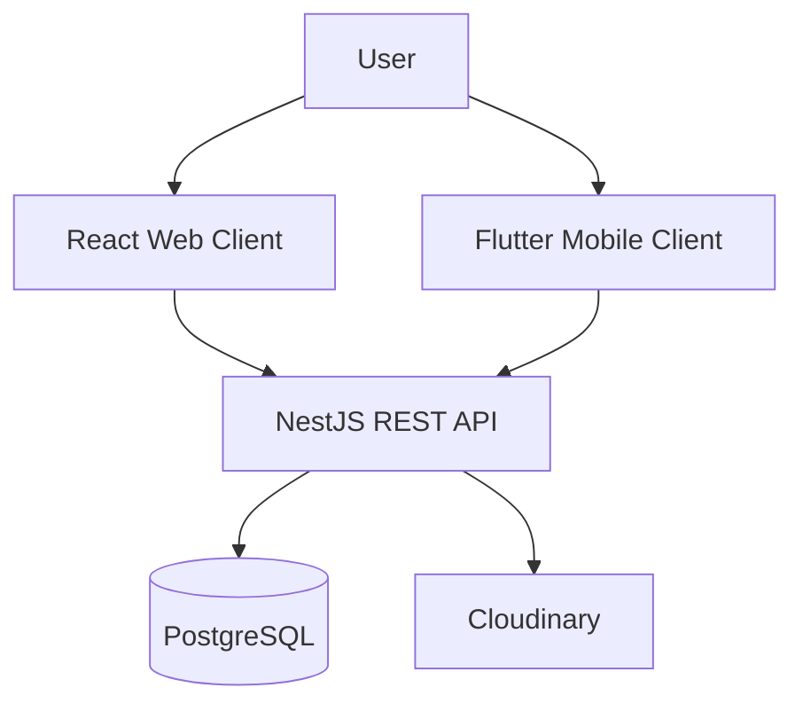

# 🌐 Social Connect

A modern, full-stack social media application built with a **NestJS** backend, **PostgreSQL** (Prisma ORM), **Cloudinary** media storage, and features both a **React** web application and a cross-platform **Flutter** mobile client.

---

## ✨ Features

- 🔐 **Authentication & Security**: JWT sessions that persist across app launches, Google sign-in, **two-factor authentication** (authenticator app + one-time recovery codes), "log out of all other devices", and password changes that sign out other sessions.
- 🔒 **Privacy controls**: private accounts with follow requests, who can message you, who can comment, activity status ("Active now"), and hidden like counts — all stored on the server, so web and mobile stay in sync.
- 🛡️ **Safety**: block and mute accounts (synced across devices), plus device-level hidden words that filter posts and comments.
- 📰 **Dynamic Feed**: "For you" and "Following" feeds with infinite scroll, suggested people, author avatars, like/comment counts and relative timestamps.
- 📸 **Post Creation**: Create posts with titles, captions, and photos uploaded directly to Cloudinary. Also supports post deletion and editing!
- 💬 **Interactive Comments & Likes**: double-tap to like, @mentions and #hashtags, post owners can moderate comments on their posts.
- 🔖 **Saved posts**: bookmarks stored on the server and shared between web and mobile.
- ✉️ **Direct Messaging**: end-to-end encrypted 1-to-1 chats with real read receipts ("Seen"), per-chat unread counts and presence.
- 👤 **Profiles & Customization**: User profile management with editable name, username, bio, and profile avatar upload.
- 👥 **Follow / Unfollow System**: Connect with other users, view follower/following lists, and explore other user profiles.
- 🔍 **User Search**: Instant user search by username or display name with debounce.
- 🔔 **Activity Notifications**: likes, comments, mentions, reposts, follows and follow requests — grouped by day, filterable, with avatars and per-type on/off switches in Settings.
- 📦 **Your data**: download a JSON export of your profile, posts, comments, likes and connections.
- 🌓 **Appearance**: light / dark / system theme on both clients; accent colours and reduced motion on web.

---

## 🏗️ Architecture & Tech Stack

### ⚙️ Backend
- **Framework**: [NestJS](https://nestjs.com/) (TypeScript)
- **Database**: PostgreSQL with [Prisma ORM](https://www.prisma.io/)
- **Media Storage**: [Cloudinary](https://cloudinary.com/) API
- **Containerization**: Docker & Docker Compose

### 💻 Web Client
- **Framework**: [React 19](https://react.dev/) + [Vite](https://vitejs.dev/)
- **Routing**: React Router
- **Networking**: Axios
- **Styling**: Vanilla CSS with responsive design

### 📱 Mobile Client
- **Framework**: [Flutter](https://flutter.dev/) (Dart)
- **State Management**: Stateful widgets & `ValueNotifier`
- **Networking**: `http` package with multipart upload support
- **Persistence**: `shared_preferences`

---

## 🧭 System Architecture



The web and mobile clients communicate with the NestJS backend. The backend uses PostgreSQL for application data and Cloudinary for uploaded media.

---

## 🗃️ Database / ER Diagram

> **Documentation TODO:** Add the ER diagram generated from the current Prisma schema. Keep entity names and relationships synchronized with the actual schema.

Suggested location: `docs/er-diagram.png`

---

## 🖼️ Screenshots

> **Documentation TODO:** Add current screenshots from the running web and Flutter applications. Use real application captures, not mockups.

Suggested folder structure:
- `docs/screenshots/web/`
- `docs/screenshots/mobile/`

| Client | Screenshots to add |
|---|---|
| Web | Login, feed, profile, messaging |
| Mobile | Login, feed, profile, messaging |

---

## 🌐 Demo

- **Live Web Demo:** Not published yet.
- **Demo Video:** Add a short walkthrough link when available.

---

## 🚀 Getting Started

### 1. Prerequisites
- Docker & Docker Compose
- Node.js (use a version supported by the project dependencies)
- Flutter SDK

### 2. Configure environment variables
Copy `backend/.env.example` to `backend/.env` and fill in:

| Variable | Purpose |
|---|---|
| `DATABASE_URL` | PostgreSQL connection string (docker-compose exposes port `5433`) |
| `JWT_SECRET` | Secret for signing login tokens — set a long random value |
| `JWT_EXPIRES_IN` | Token lifetime, default `7d` |
| `CLOUDINARY_CLOUD_NAME` / `CLOUDINARY_API_KEY` / `CLOUDINARY_API_SECRET` | Image uploads |
| `GOOGLE_CLIENT_ID` | Google Sign-In token verification |

The web client reads optional `VITE_API_URL` (default `http://localhost:3000`) and `VITE_GOOGLE_CLIENT_ID` from `web/.env`.

> Never commit real passwords, API secrets, or private keys. Keep local environment files out of Git.

### 3. Start the database
```bash
docker-compose up -d
```

### 4. Start the backend
```bash
cd backend
npm install
npm run start:dev
```
Backend is expected at `http://localhost:3000` with the default local configuration.

### 5. Start the web client
Open a second terminal:
```bash
cd web
npm install
npm run dev
```
Vite usually serves the web client at `http://localhost:5173`.

### 6. Start the mobile client
Open another terminal:
```bash
cd mobile
flutter pub get
flutter run
```

For a physical phone, configure the API base URL to use the computer's reachable LAN IP rather than `localhost`.

---

## 🧪 Testing

Run the tests supported by each package before submitting changes:

- **Backend API (integration):** start the database and backend, then `cd backend && npm run test:api`.
  Two suites (`test/api-core.smoke.mjs`, `test/api-settings.smoke.mjs`) exercise auth, posts, comments,
  privacy, blocking, 2FA and sessions against the running API. They create throwaway users and delete them.
- **Backend type-check:** `cd backend && npx tsc --noEmit -p tsconfig.json`
- **Mobile:** `cd mobile && flutter analyze && flutter test`
- **Web:** `cd web && npm run build` (type-check + production build) and `npm run lint`.

> The generated Jest specs in `backend/src/**/*.spec.ts` don't run under TypeScript 6 + ESM yet;
> `npm run test:api` is the maintained backend test suite for now.

### Database changes

The data contract lives in `backend/src/prisma/contract.prisma` (Prisma Next). After editing it:

```bash
cd backend
npx prisma contract emit
npx prisma db update --dry-run   # review: should list only additive operations
npx prisma db update
```

---

## 📡 API Overview (Key Endpoints)

| Method | Endpoint | Description |
|---|---|---|
| `POST` | `/auth/register` | Register new user account |
| `POST` | `/auth/login` | Log in and receive JWT token |
| `GET` | `/users/me` | Fetch authenticated user profile & stats |
| `GET` | `/users/search?q=:query` | Search users by keyword |
| `POST` | `/users/:id/follow` | Toggle follow/unfollow status |
| `GET` | `/posts?page=1&limit=10` | Get paginated feed posts |
| `POST` | `/posts` | Create new post |
| `PATCH` | `/posts/:id` | Update post content |
| `DELETE` | `/posts/:id` | Delete post |
| `POST` | `/likes/:postId` | Toggle like on post |
| `GET` | `/comments/:postId` | Get comments for a post |
| `GET` | `/messages/:userId` | Get chat history with user |
| `POST` | `/messages/:userId` | Send a direct message |
| `GET` | `/notifications` | Get user notifications |
| `GET` | `/notifications/unread-count` | Unread total plus a per-type breakdown (`byType`) |
| `PATCH` | `/notifications/read-all?type=` | Mark all (or one type) as read |
| `DELETE` | `/notifications` / `/notifications/:id` | Clear all / remove one notification |
| `GET` | `/posts?scope=following` | Feed limited to people you follow (plus your own posts) |
| `GET` | `/posts/:id` | Single post (powers shareable `/post/:id` links) |
| `GET` | `/users/suggestions` | People you may know (follows-you, mutuals, popularity) |
| `GET` | `/follows/followers/:userId` | Followers, each with `isFollowing` / `isRequested` for the viewer |
| `GET` / `PATCH` | `/users/me/settings` | Privacy, notification and interaction settings |
| `GET` | `/follows/requests` | Pending follow requests (private accounts) |
| `POST` | `/follows/requests/:userId/approve` · `/decline` | Answer a follow request |
| `POST` / `DELETE` | `/users/:id/block` · `/users/:id/mute` | Block / mute (and undo) |
| `GET` | `/users/me/blocked` · `/users/me/muted` | Your block and mute lists |
| `POST` / `DELETE` | `/posts/:id/save` · `GET /posts/saved` | Saved posts |
| `GET` | `/posts/search?q=` | Search posts and #hashtags |
| `GET` | `/users/by-username/:username` | Resolve an @mention |
| `GET` | `/messages/unread-count` · `/messages/info/:userId` | Unread messages; presence + can-reply for a chat |
| `POST` | `/auth/2fa/setup` · `/enable` · `/disable` · `/verify` | Two-factor authentication |
| `POST` | `/auth/logout-all` | Sign out every other device |
| `PATCH` | `/auth/email` | Change email (password required) |
| `GET` | `/users/me/export` | Download your data |

---

## 🗺️ Roadmap

- [ ] Add verified web and mobile screenshots
- [ ] Add ER diagram based on the current database schema
- [ ] Publish a demo video or deployment link
- [ ] Document exact environment variables and migration steps
- [ ] Add verified test coverage and CI workflow details

---

## 📄 License

This project is licensed under the MIT License.
